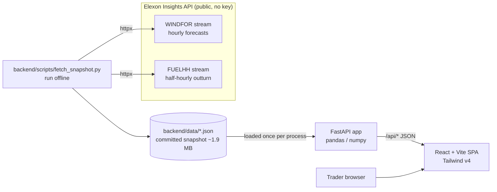

# Design notes: Wind Forecast Day-Ahead Tool (v1)

Audience: internal technical lead. This explains how the system works, why it is built this way, and what comes next. The HTTP interface is specified in [`api-contract.md`](./api-contract.md).

## 1. Problem

The day-ahead trading team buys power for delivery day **D** on **D−1**, before the GB day-ahead auction gate (about 09:20 UK time). Wind is the biggest swing factor in what they need to buy, so they need two things:

1. **The forecast they actually had at decision time.** For each delivery day, this is the latest national wind forecast (Elexon WINDFOR) published before the cutoff.
2. **How far to trust that forecast.** This is the forecast error against outturn (Elexon FUELHH, `fuelType=WIND`), measured for decisions made in January 2026 and turned into an uncertainty band they can size a purchase against.

## 2. Architecture



Deployment topologies:

```
Docker (local / any host)                 Vercel
-------------------------                 ------
browser :8080                             browser
   │                                         │
nginx (frontend container)                Vercel CDN ── frontend/dist (static)
   ├── /        -> dist/ (SPA fallback)      │
   └── /api/*   -> backend:8000             /api/*  ── rewrite ──> api/index.py
                    │                                              (Python function,
              uvicorn app.main:app                                  imports backend/app.main)
```

- **Backend**: a FastAPI package `app` rooted at `backend/`. It loads both JSON snapshots into pandas DataFrames once per process and caches them. All endpoints compute their results from these in-memory frames.
- **Frontend**: a single-page app that only calls the relative path `/api`. Because of that, the same build works behind nginx (Docker) and on Vercel without any environment configuration.
- **Vercel**: `api/index.py` is a file-based Python function that adds `backend/` to `sys.path` and re-exports `app` from `app.main`. A rewrite sends `/api/(.*)` to `/api/index`. The original request path is passed to the ASGI app, so the FastAPI routes keep their `/api` prefix.

## 3. Data facts (verified against the live API)

| Fact | Value |
|---|---|
| Authentication | None. The Elexon Insights API is public. |
| WINDFOR resolution | Hourly target `startTime` |
| WINDFOR runs | 8 per day, at 02:30, 04:30, 07:30, 09:30, 11:30, 15:30, 18:30 and 22:30 UTC |
| Points per run | 73, starting from 21:00 on the prior day |
| Horizons in a run | −25.5 h to +66.5 h. We keep **0 to 48 h**. |
| FUELHH resolution | Half-hourly settlement periods, in MW |
| Join | Forecasts are matched to actuals only at hourly `startTime`s (the `:00` actual) |
| Snapshot window | Actuals for settlement dates 2026-01-01 to 2026-02-01. Forecasts published 2025-12-30 to 2026-02-01. |
| Decision cutoff | The default is 09:00 UTC on D−1. That selects the **07:30 run**, the last run before the ~09:20 auction gate. |

Negative horizons appear because each run restates recent past hours. Those rows are not forecasts and are dropped.

## 4. Forecast-selection algorithms

Definitions: `horizon_h = startTime − publishTime` in hours. `error = forecast − actual` in MW. A positive error means wind was over-forecast, which leaves the team **short**.

### 4.1 Horizon selection (Explorer and Accuracy pages)

For each hourly target `t` and requested horizon `H`, pick the forecast with the **largest `publishTime` such that `publishTime ≤ t − H`** and `t − publishTime ≤ 48 h`.

This answers: "what was the freshest forecast that was at least H hours old?" Runs come out every 2 to 4 hours, so the horizon actually used is between `H` and roughly `H + 4`. The value is reported per point as `horizon_h`. One implementation is `pandas.merge_asof` on `publishTime`, grouped by `startTime`. Another is a sorted search per target.

The horizon curve (`/api/metrics/horizon-curve`) repeats this for H = 0…48 to show how error grows with lead time.

### 4.2 Day-ahead cutoff selection (Day-Ahead page)

For delivery date `D` and cutoff `HH:MM`, take the **single latest run with `publishTime ≤ (D−1)THH:MM:00Z`**, and read all 24 hourly points of D from that run.

This is different from horizon selection on purpose. A trader commits to one run for the whole day. They do not get a different run for each hour. With the 09:00 cutoff the run is the 07:30 run on D−1, and the per-hour horizons run from 16.5 h (00:00 on D) to 39.5 h (23:00 on D).

### 4.3 Out-of-sample P10/P90 band

For a selected delivery date D at a given cutoff:

1. Compute day-ahead errors (4.2) for **every other** January delivery date at the same cutoff. D itself is excluded, so the band is never fitted on the day it is judged against.
2. Take the empirical error quantiles q10 and q90 of that pool, about 30 days × 24 h ≈ 700 points.
3. For each hour: `p10 = forecast − q90(error)` and `p90 = forecast − q10(error)`.

Read it as an 80% band for the **actual** wind given the forecast. Hourly P10/P90 values are summed to give `p10_energy_mwh` and `p90_energy_mwh`. Summing hourly quantiles does not give a strict daily quantile, because errors are autocorrelated. The summed band is a conservative, easy-to-explain proxy (see Limitations).

## 5. Metric definitions

| Metric | Definition |
|---|---|
| `n` | Number of matched (forecast, actual) hourly pairs |
| `mae` | mean(\|error\|), MW |
| `rmse` | sqrt(mean(error²)), MW |
| `bias` | mean(error), MW. Positive means over-forecast. |
| `mape` | mean(\|error\| / actual) × 100, excluding actual < 1000 MW (avoids division blow-up at low wind) |
| `nmae_pct` | mae / mean_actual × 100 |
| `p50/p90/p99_abs_error` | Quantiles of \|error\| (tail risk) |
| `error_quantiles` | p10, p50 and p90 of the signed error (the band inputs) |
| `histogram` | Signed error counts in 500 MW bins |
| Hourly profile | MAE and bias grouped by UTC hour of day |
| Day-ahead summary | Energy (MWh) = sum of hourly MW × 1 h. Peak and minimum forecast. MAE and bias over the day's 24 points. |

## 6. Key trade-offs

| Decision | Why | Cost |
|---|---|---|
| **Committed snapshot instead of live fetch** | The WINDFOR stream for a month is about 50k rows. Fetching it on a serverless cold start is slow and depends on Elexon being up. A 1.9 MB JSON loads in well under a second, and the results can be reproduced exactly. | Data is fixed to January 2026 until someone runs `fetch_snapshot.py` again. |
| **pandas/numpy in a serverless function** | The joins, quantiles and `merge_asof` are concise and correct, and the code reads like the analysis. | Bigger bundle and cold start (pandas plus numpy is about 100 MB unpacked, well under Vercel's 500 MB limit). Pure Python would be lighter but harder to check. |
| **UTC everywhere** | January is GMT, so UTC equals UK local time and the gate and run times line up exactly. | **Only valid in winter.** In BST the 09:00 cutoff would be 08:00 UTC, which changes which run gets picked. See the roadmap. |
| **Hourly join** | WINDFOR is hourly. Comparing it with the `:00` half-hour actual avoids making up forecast values by interpolation. | The `:30` actuals are not used for scoring. A half-hour that is not representative of its hour adds some noise. |
| **One run per delivery day** | Matches how a trader actually works (one decision per day before the gate). | Not the best accuracy possible. Later runs are better but arrive too late to act on. |
| **Relative `/api` base URL** | One frontend build serves Docker, Vite dev (proxy) and Vercel. | Frontend and API must be on the same origin, or behind a proxy. |

## 7. Testing approach

- **Backend unit tests** (`backend/tests`, pytest + FastAPI `TestClient`):
  - Selection rules on small synthetic frames: the latest run that is not after the cutoff, the horizon boundaries (0 and 48 h), and removal of negative horizons.
  - Metric formulas checked against hand-computed values: MAE, RMSE, bias, MAPE threshold and the histogram bins.
  - Out-of-sample band: the selected day must not affect its own quantiles.
  - API contract: status codes (422 for invalid parameters, 404 for an unknown delivery date), response shapes and default ranges.
- **Data sanity checks**, run against the real snapshot. The 09:00 cutoff should select 07:30 runs. Every January delivery date should have 24 points.
- **Frontend**: TypeScript type-check (`tsc`) and a production build (`vite build`) in CI. Before a release, a manual smoke test of all three pages against the Docker stack.

## 8. Limitations and roadmap

**Limitations in v1**
- Only January 2026, from a static snapshot.
- UTC is assumed to equal UK local time. That is wrong during BST.
- The band is an unconditional empirical quantile of about 30 days of data. It does not change with wind level, weather regime or hour of day.
- The daily energy band is a sum of hourly quantiles, not a true daily quantile.
- Wind only. The app does not model demand, so the "buy residual" is left to the trader.

**Roadmap**
1. **Live refresh**: a scheduled job (Vercel Cron or GitHub Action) that runs `fetch_snapshot.py` every day and writes to object storage or a small database instead of the repository.
2. **BST handling**: store times as UTC and apply the cutoff in `Europe/London`. Show times in UK local time.
3. **Demand integration**: bring in the national demand forecast (Elexon NDF/TSDF) and show the residual `demand − wind` directly, with its own P10/P90.
4. **Probabilistic forecasts**: a band that depends on the forecast level and hour (quantile regression or binned quantiles), and daily energy quantiles from block bootstrap.
5. **More months**: a rolling 12-month backtest, and seasonal comparison across winter and summer and across horizons.
6. **Run comparison**: show how the D-1 forecast changed across the 02:30, 04:30, 07:30 and 09:30 runs, to judge whether waiting for a later run is worth it.
